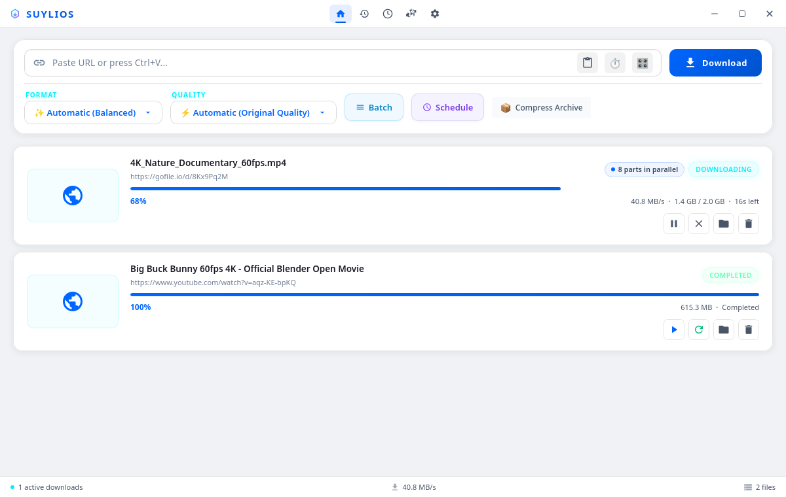
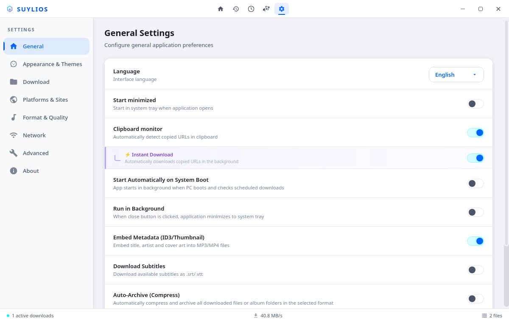
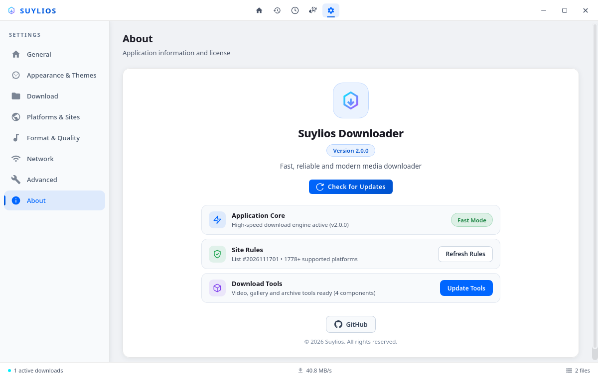
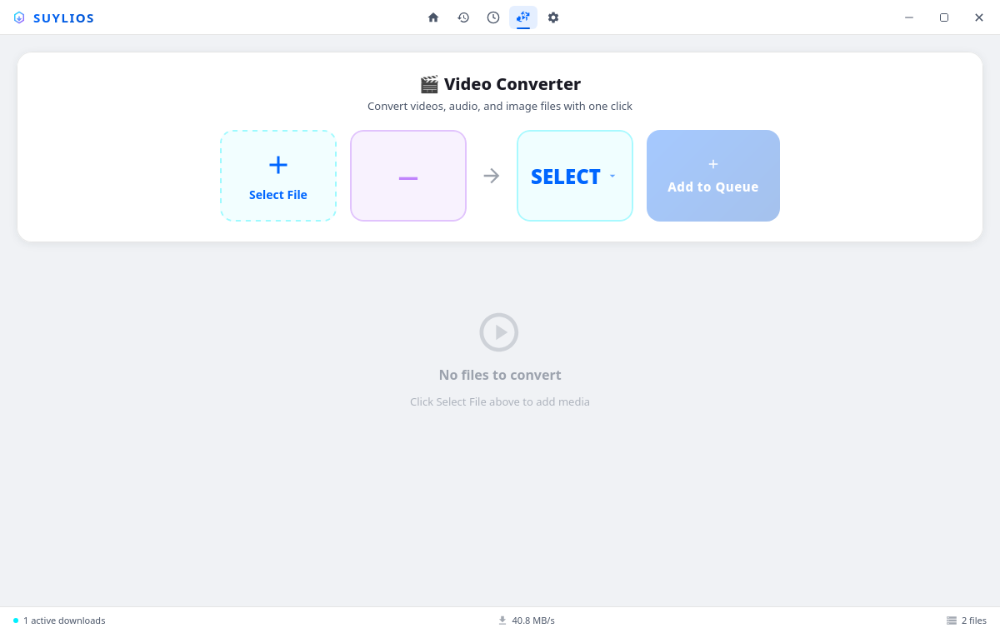

# Suylios Downloader

Desktop media, gallery, and file downloader for Windows and Linux, powered by a Rust download engine.

  
  
  
  
  
  

  <a href="#features">Features</a> •
  <a href="#screenshots">Screenshots</a> •
  <a href="#download">Download</a> •
  <a href="SUPPORTED_SITES.md">Supported Sites</a> •
  <a href="https://wiki.sayrias.com/suylios-downloader/v1/overview">Wiki</a>

---

## Overview

Suylios Downloader is a desktop application for downloading videos, audio, image galleries, albums, and hosted files from over **1,775 websites** through a single interface.

Starting with **v2.0.0**, file transfers are handled by a compiled **Rust download engine** that splits large files across parallel connections, writes directly to the target file without waiting to merge parts at the end, and resumes interrupted downloads from the exact remaining byte ranges.

---

## Features

- **Rust Download Engine:** Multi-connection segmented downloading with adaptive concurrency, seamless pause/resume, and built-in DNS-over-HTTPS support.
- **1,775+ Supported Platforms:** Downloads videos (up to 4K/8K), playlists, audio tracks, image galleries, and cloud host albums including YouTube, TikTok, X/Twitter, Instagram, Reddit, Twitch, Gofile, Bunkr, Pixeldrain, Mega.nz, and more. See the full list in [SUPPORTED_SITES.md](SUPPORTED_SITES.md).
- **Custom Site Folders & Cookies:** Organize downloads automatically by platform, add dedicated cards for any supported site, and configure per-site quality or cookie settings.
- **Background Instant Download:** Copies a supported URL from your browser and starts downloading automatically in the background—even while minimized to the system tray.
- **Built-in Media Converter:** Convert local video, audio, and image files (MP4, MKV, MP3, FLAC, WAV, GIF, WEBP, and more) with bundled FFmpeg support.
- **Flexible Queue Controls:** Batch URL input, drag-and-drop queue reordering, sequential download mode, scheduled downloads, auto-archiving (ZIP, 7z, TAR, RAR), video trimming, and post-download shutdown/sleep actions.
- **Live Component & Rule Updates:** Refresh site rules and update download tools directly from the **About** panel without reinstalling the application.
- **Themes & Languages:** Includes 6 built-in themes (Light default, Dark, Cyber, Matrix, Crimson, Sunset), a custom theme editor, and English / Turkish interface languages.
- **Portable & Local-Only:** Works in both installed and portable modes. All downloads, settings, and history remain locally on your device with zero telemetry.

---

## Screenshots

### Main Window

### Settings & Instant Download

### About & Update Center

### Media Converter

---

## Download

Prebuilt packages for Windows and Linux are available on the [Releases](https://github.com/sayrias/suylios-downloader/releases) page:

| Platform | Package | Notes |
| :--- | :--- | :--- |
| **Windows** | `Suylios-Setup.exe` | Standard Windows installer |
| **Windows** | `Suylios.exe` | Single-file standalone executable |
| **Windows** | `Suylios-Portable.zip` | Portable archive (stores config and downloads in folder) |
| **Linux** | `Suylios-Linux.AppImage` | Single-file AppImage (`chmod +x Suylios-Linux.AppImage && ./Suylios-Linux.AppImage`) |

### Running from Source

- **Linux:** `./baslat.sh`
- **Windows:** `baslat.bat`

For detailed guides and troubleshooting, visit the [Official Wiki](https://wiki.sayrias.com/suylios-downloader/v1/overview).

---

## License

Released under the [MIT License](LICENSE).
